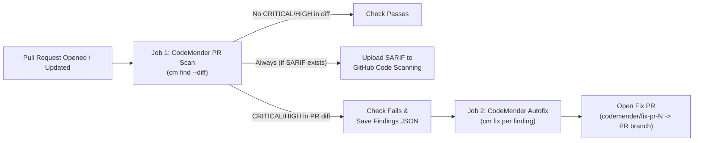

# CodeMender CI/CD Demo (`CloudVault`)

This repository demonstrates how to integrate **Google Cloud CodeMender** (`cm` CLI) into **GitHub Actions** to scan pull requests for security vulnerabilities before code reaches production, surface findings in **GitHub Code Scanning (SARIF)**, and automatically open a **fix pull request** using AI-generated patches.

> **Official Documentation**
> - [CodeMender Overview](https://docs.cloud.google.com/gemini-enterprise-agent-platform/agents/codemender)
> - [Integrate CodeMender with CI/CD](https://docs.cloud.google.com/gemini-enterprise-agent-platform/agents/codemender/integrate-with-cicd)

---

## How CodeMender Works in CI/CD

CodeMender is an AI code security agent on Google Cloud's **Gemini Enterprise Agent Platform**. Unlike traditional static analysis tools that rely solely on syntactic pattern matching, CodeMender:

1. **Local-First Execution + Cloud Reasoning**: The `cm` CLI runs inside your GitHub Actions runner, keeping your repository in your CI environment and sending only surgical code snippets and tool results to the Gemini Enterprise Agent Platform.
2. **Differential PR Scanning (`cm find --diff`)**: Compares the pull request branch against the base branch (`origin/$BASE_REF`), scanning modified files and their direct dependencies (callers/importers).
3. **Legacy Noise Suppression**: Pre-existing vulnerabilities in untouched code are labeled `[LEGACY / UNTOUCHED]`. They still appear in the SARIF report for visibility, **but only vulnerabilities introduced or exposed by the PR fail the CI check**.
4. **Autonomous Remediation (`cm fix`)**: When `CRITICAL` or `HIGH` vulnerabilities are found in the PR diff, a second job runs `cm fix` for each finding and opens a pull request (`codemender/fix-pr-<NUMBER>`) targeting your PR branch.



---

## Repository Structure

```text
.
├── .github/workflows/
│   ├── ci.yml                  # Runs pytest unit tests on push & PR
│   └── codemender.yml          # CodeMender PR diff scan, SARIF upload & autofix PR
├── app/
│   ├── __init__.py
│   ├── db.py                   # SQLite connection & schema initialization
│   └── main.py                 # CloudVault FastAPI application
├── tests/
│   └── test_app.py             # Pytest unit tests
├── requirements.txt
└── README.md
```

---

## Prerequisites

1. **Google Cloud Project** with billing enabled and access to **CodeMender** (Public Preview on Gemini Enterprise Agent Platform).
2. **GitHub Repository** with **GitHub Actions** enabled.
   - *Note on GitHub Code Scanning*: Free for public repositories. Private/internal repositories require **GitHub Code Security**. If Code Scanning is unavailable on your repo, remove the `Upload results to GitHub Code Scanning` step and the `security-events: write` permission from [`.github/workflows/codemender.yml`](.github/workflows/codemender.yml).

---

## Step 1: Configure Google Cloud Workload Identity Federation (Keyless Auth)

Rather than storing long-lived service account JSON keys in GitHub, the workflow uses **Workload Identity Federation (WIF)** with GitHub OIDC tokens.

Run the following commands in Google Cloud Shell (or your local terminal with `gcloud`):

```bash
# 1. Set your variables
export PROJECT_ID="your-gcp-project-id"
export GITHUB_ORG="nael-fridhi"
export GITHUB_REPO="codemender-cicd"
export POOL_ID="github-actions-pool"
export PROVIDER_ID="github-oidc-provider"
export SA_NAME="codemender-ci"

gcloud config set project "${PROJECT_ID}"

# 2. Enable required Google Cloud APIs
gcloud services enable \
  aiplatform.googleapis.com \
  cloudresourcemanager.googleapis.com \
  iam.googleapis.com \
  iamcredentials.googleapis.com \
  sts.googleapis.com

# 3. Create a dedicated CI/CD service account and grant Agent Platform User role
gcloud iam service-accounts create "${SA_NAME}" \
  --display-name="CodeMender CI/CD Service Account"

export SA_EMAIL="${SA_NAME}@${PROJECT_ID}.iam.gserviceaccount.com"

gcloud projects add-iam-policy-binding "${PROJECT_ID}" \
  --member="serviceAccount:${SA_EMAIL}" \
  --role="roles/aiplatform.user"

# 4. Create the Workload Identity Pool
gcloud iam workload-identity-pools create "${POOL_ID}" \
  --location="global" \
  --display-name="GitHub Actions Pool"

# 5. Create the GitHub OIDC Provider (scoped to your GitHub org/user)
gcloud iam workload-identity-pools providers create-oidc "${PROVIDER_ID}" \
  --location="global" \
  --workload-identity-pool="${POOL_ID}" \
  --display-name="GitHub OIDC Provider" \
  --attribute-mapping="google.subject=assertion.sub,attribute.actor=assertion.actor,attribute.repository=assertion.repository,attribute.repository_owner=assertion.repository_owner" \
  --attribute-condition="assertion.repository_owner == '${GITHUB_ORG}'" \
  --issuer-uri="https://token.actions.githubusercontent.com"

# 6. Allow your specific GitHub repository to impersonate the service account
export PROJECT_NUMBER=$(gcloud projects describe "${PROJECT_ID}" --format="value(projectNumber)")

gcloud iam service-accounts add-iam-policy-binding "${SA_EMAIL}" \
  --role="roles/iam.workloadIdentityUser" \
  --member="principalSet://iam.googleapis.com/projects/${PROJECT_NUMBER}/locations/global/workloadIdentityPools/${POOL_ID}/attribute.repository/${GITHUB_ORG}/${GITHUB_REPO}"

# 7. Print the values needed for GitHub Secrets
echo "GCP_PROJECT_ID=${PROJECT_ID}"
echo "GCP_WIF_PROVIDER=projects/${PROJECT_NUMBER}/locations/global/workloadIdentityPools/${POOL_ID}/providers/${PROVIDER_ID}"
echo "GCP_WIF_SERVICE_ACCOUNT=${SA_EMAIL}"
```

---

## Step 2: Configure GitHub Repository Secrets & Settings

### 1. Add Repository Secrets
Go to **Settings > Secrets and variables > Actions > New repository secret** (or use `gh secret set`) and add:

| Secret Name | Value |
| --- | --- |
| `GCP_PROJECT_ID` | Your Google Cloud project ID |
| `GCP_WIF_PROVIDER` | Full provider resource name (`projects/<PROJECT_NUMBER>/locations/global/workloadIdentityPools/github-actions-pool/providers/github-oidc-provider`) |
| `GCP_WIF_SERVICE_ACCOUNT` | `codemender-ci@<PROJECT_ID>.iam.gserviceaccount.com` |

### 2. Enable Automated Pull Requests
To allow the `autofix` job to open pull requests with fixes:
1. Go to **Settings > Actions > General**.
2. Under **Workflow permissions**, select **Read and write permissions** (or keep default and rely on the workflow's `permissions:` block) and check **Allow GitHub Actions to create and approve pull requests**.
3. Click **Save**.

---

## Step 3: Understanding `.github/workflows/codemender.yml`

### Job 1: `scan` (`CodeMender PR Scan`)
- **Full Git History (`fetch-depth: 0`)**: Required so `cm find --diff="origin/$BASE_REF"` can compute the diff against the base branch.
- **CLI Installation**: Downloads the latest stable `cm` binary from Google Artifact Registry into `$RUNNER_TEMP/bin`.
- **Differential Scan**:
  ```bash
  cm find . \
    --diff="origin/$BASE_REF" \
    --fail-on="CRITICAL,HIGH" \
    --sandbox=false \
    --format=sarif \
    --output=codemender.sarif
  ```
- **SARIF Upload**: Runs `github/codeql-action/upload-sarif@v4` with `if: ${{ !cancelled() && hashFiles('codemender.sarif') != '' }}` so findings are always visible in the **Security > Code scanning** tab even when the scan fails the PR check.
- **Artifact Export**: When findings exceed `--fail-on`, exports `codemender-findings.json` via `cm report --format=json --status=OPEN` for the `autofix` job.

### Job 2: `autofix` (`CodeMender Autofix`)
- **Condition**: Runs only when `scan` fails and saved findings (`if: ${{ failure() && needs.scan.outputs.has_findings == 'true' }}`).
- **Automated Patching**: Imports the findings, iterates over each `OPEN` finding, and runs:
  ```bash
  cm fix "$id" --sandbox=false --yes --bypass-warning < /dev/null
  ```
- **Clean Commits**: Commits each fix separately and discards any temporary/untracked files created during test verification (`git reset -q --hard && git clean -q -fd`).
- **Fix Pull Request**: Uses `peter-evans/create-pull-request@v8` to open (or update) a PR from `codemender/fix-pr-<NUMBER>` into your PR's branch.

### Customization Options
- **Change severity threshold**: Update `FAIL_ON` in `env:` (e.g., `CRITICAL,HIGH,MEDIUM` or `""` to report without blocking).
- **ASCII-only logs**: Add `CM_PLAIN: "true"` to `env:` (or pass `--plain` to `cm` commands).
- **Pre-flight diagnostics**: Run `cm health --strict` before scanning to verify credentials, network reachability, and IAM permissions.
- **Disable autofix**: Remove the `autofix` job and the `Save findings for autofix` step.

---

## Security Considerations

- **Ephemeral Runners Only**: The workflow uses `--sandbox=false` because unprivileged CI containers may not support Linux user namespaces required by the local OS sandbox. Always run this on **GitHub-hosted ephemeral runners** (`ubuntu-24.04`)—never on persistent self-hosted runners shared across jobs.
- **Forks & Dependabot**: The `scan` job skips PRs from forks and `dependabot[bot]` because those workflows cannot access repository secrets. Review fork PRs manually or scan them locally with `cm find --diff`.
- **Human-in-the-Loop**: AI-generated patches should always be reviewed before merging. GitHub does not automatically trigger workflows on PRs created with `GITHUB_TOKEN`; click **Approve and run** on the fix PR to run `CI Tests` before merging.

---

## Demo Walkthrough

This repository includes a **`demo/vulnerable-pr`** branch to demonstrate the end-to-end CodeMender workflow:

1. **Clean Baseline (`main`)**:
   - `app/main.py` uses parameterized SQLite queries and passes all checks in `CI Tests`.
2. **Open a Vulnerable Pull Request**:
   - Open a PR from **`demo/vulnerable-pr`** into **`main`** (this branch adds a `/notes/search` endpoint with **SQL Injection** and a `/notes/export` endpoint with **Command Injection**).
3. **CodeMender Detects & Blocks**:
   - `CodeMender PR Scan` runs `cm find --diff="origin/main"`, detects the `CRITICAL`/`HIGH` vulnerabilities in the PR diff, uploads `codemender.sarif` to **Security > Code scanning**, and fails the PR check.
4. **CodeMender Opens an Autofix PR**:
   - `CodeMender Autofix` runs `cm fix` on each finding, commits the patches, and opens **`CodeMender fixes for #<PR>`** (`codemender/fix-pr-<PR>` -> `demo/vulnerable-pr`).
5. **Review, Test & Merge**:
   - Review the AI-generated diff in the fix PR, approve the `CI Tests` workflow on the fix PR, merge the fix PR into `demo/vulnerable-pr`, and watch the original PR re-scan and pass.
